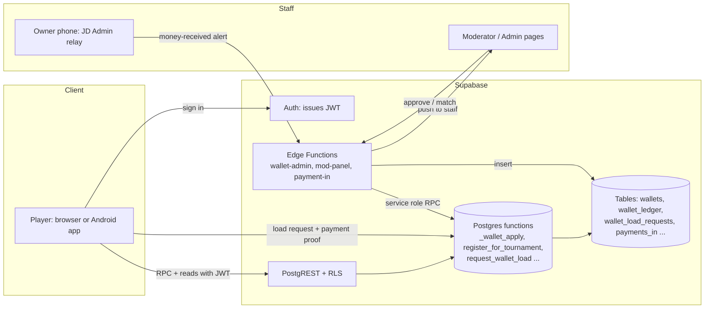

# JD Esports Arena: architecture

JD Esports Arena is a Free Fire tournament site for players in Nepal. Players sign up, join events, and use a points wallet (1 point = Rs 1). They load points by paying with eSewa or Khalti. They spend points on entries and extras. Winners get prizes as points and can ask to withdraw them.

This page explains how the system is built. It covers how money moves, how double spending is stopped, and one real incident. All paths are relative to the repo root unless they say otherwise.

## 1. The parts

| Part | What it is |
| --- | --- |
| Website | Static HTML, CSS and JavaScript. No build step for most pages. Served from GitHub Pages. |
| Android app | A small wrapper that opens the website. Since version 2.0 it is a WebView app. Before 2.0 it was a Trusted Web Activity (`jd-android/app/app/src/main/AndroidManifest.xml:2-3`, separate folder). |
| Supabase Auth | Sign-up and sign-in. Every database call carries the player's JWT. |
| PostgREST + Postgres | The browser calls Postgres functions (RPC) and reads tables directly. Row Level Security (RLS) decides what each player can see. |
| Postgres functions | All money logic lives here, as `SECURITY DEFINER` functions in `supabase/*.sql`. |
| Edge Functions | Deno/TypeScript functions in `supabase/functions/`. They do admin, moderator and integration work with the service role. |
| JD Admin relay | A small native Android app on the owner's phone. It forwards "money received" alerts from the wallet apps. Its source is not published; paths below that start with `jd-android/` are in a private folder. |

## 2. Data flow

In words:

1. A player signs in. Supabase Auth gives the browser a JWT.
2. The browser calls Postgres functions through PostgREST. Each function reads `auth.uid()` from the JWT, so a player can only act as themself.
3. To load points, the player pays by eSewa or Khalti, then sends a load request with proof (`request_wallet_load`, latest version `supabase/load_proof.sql:95`).
4. When money arrives, the wallet app on the owner's phone shows a notification. The JD Admin relay forwards it to the `payment-in` Edge Function (`supabase/functions/payment-in/index.ts`). That function stores it in `payments_in` and sends a push to staff.
5. A load request is approved by matching it to one stored payment, or by the admin. Approval credits points through one internal function.

## 3. Security model

- **RLS on player tables.** Players can read only their own wallet, ledger, load requests and withdrawals (`supabase/schema.sql:1381`, `:1398`, `:1413`, `:3260`). There are no player INSERT or UPDATE policies on these tables.
- **Writes only through functions.** The comment at `supabase/schema.sql:104-116` explains why: a plain insert policy cannot enforce a slot limit or stop two requests at once. So all writes go through `SECURITY DEFINER` functions that check the rules inside one transaction.
- **Internal functions are not callable by players.** `_wallet_apply` and `admin_wallet_credit` are revoked from `anon` and `authenticated` and granted only to `service_role` (`supabase/schema.sql:1838-1839`, `:2132-2133`).
- **Edge Functions check the caller first.** `mod-panel` verifies the user's JWT and looks the user up in the `moderators` table before it does anything (`supabase/functions/mod-panel/index.ts:191-194`). `wallet-admin` is admin-only (`supabase/functions/wallet-admin/index.ts:1-12`). Moderators cannot credit points freely. Their actions that move points (for example matching a load to a stored payment, refunds when a squad is removed, prizes that cannot exceed the event's posted prize pool) go through SQL functions with their own checks, and every moderator action is logged (`supabase/functions/mod-panel/index.ts:14`, `:743-746`).
- **Kill switch.** Every points movement first calls `_assert_open()` (`supabase/schema.sql:1964`, `:1977`). If the system is locked, nothing moves.

## 4. Wallet and ledger: how double spending is stopped

There are two tables. `wallets` holds one balance per player. `wallet_ledger` holds one row per change: the change (`delta`), the new balance, a reason and a reference (`supabase/schema.sql:1374-1394`).

Every balance change goes through one function, `_wallet_apply` (latest version `supabase/schema.sql:1973`). It does this, in one transaction:

1. Locks the player's wallet row: `SELECT ... FOR UPDATE` (`:1982`). A second transaction for the same wallet must wait.
2. For a spend, runs a conditional update: `UPDATE wallets SET balance = balance + p_delta WHERE ... AND balance >= -p_delta RETURNING balance` (`:1986-1988`). If no row comes back, the player does not have enough points and the function raises an error.
3. Writes the ledger row with `balance_after`.

Other layers back this up:

- **CHECK constraint.** `balance >= 0` on the table (`:1376`). Even a bug cannot store a negative balance.
- **Append-only ledger.** A trigger refuses UPDATE, and refuses DELETE while the player exists (`:2049-2063`).
- **Balance only moves with a ledger row.** A deferred constraint trigger checks, at commit, that a changed balance has a matching ledger row in the same transaction (`:2066-2079`).
- **No double credit.** Partial unique indexes on `ref` allow only one ledger row per reference for loads, prizes and refunds (`:1394`, `:1857`, `supabase/audit_fixes_2026_10_29.sql:104`). A load request also needs a payment reference that can be used only once (`supabase/load_proof.sql:18`). A stored payment can pay only one load (`supabase/payments_in.sql:14`, `supabase/payments_in_v2.sql:14`).
- **No double registration.** `registrations` has `unique (tournament_slug, player_id)` (`supabase/schema.sql:98`). `register_for_tournament` also takes a per-event advisory lock before it counts slots (`supabase/mod_commission_waitlist.sql:493`). The charge happens in the same transaction as the insert, so a second click fails on the unique key and nothing is charged twice.
- **Never charge a stale price.** On the paths where registration takes points, the page sends the price the player saw (`p_price_seen`). The function refuses if it differs from the real price (`supabase/mod_commission_waitlist.sql:510`, `:551`).
- **Automatic audit.** `security_sweep()` compares each wallet's balance with the sum of its ledger rows. If any differ, it locks the system and alerts the admin (`supabase/schema.sql:2082-2112`). It runs on a schedule with `pg_cron` (`:2182`).

**What the arena does not have.** It has no client idempotency keys and no stored request hash. Retries are made safe by the unique references, the unique registration key and the row and advisory locks above. The ledger is single-entry (one row per wallet change), not double-entry. It runs at Postgres's default isolation level (READ COMMITTED) with explicit locks.

**A separate, cleaner version.** `jd-ledger` (a different public repo) re-implements the same idea from scratch. It is not used by the arena. It has real idempotency keys with a request hash, double-entry rows that must sum to zero, and locking of several accounts in id order (`jd-ledger/jd_ledger/ledger.py:224-244`).

## 5. Why a notification relay, not a merchant API

**The problem.** The project has no merchant API access for eSewa or Khalti. A merchant account needs a registered business. So the server cannot ask the payment provider "did this payment happen?".

**The choice.** The owner's phone already gets a "money received" notification for every payment. JD Admin is a small Android `NotificationListenerService` (`jd-android/relay/app/src/main/java/uk/co/jdesport/relay/RelayService.java:10`). Android wakes it only when a notification is posted, so there is no polling. It ignores every app that is not a wallet app (`RelayService.java:38`). It keeps a small queue on the phone and retries when the internet comes back (`Relay.java:37-59`, `:113-135`). After a restart it re-sends recent alerts, and the server ignores duplicates (`RelayService.java:13-24`). The v2.3.0 APK is 29,425 bytes.

**The server side.** `payment-in` checks that the caller is the relay. It keeps only money-received alerts and never stores one-time codes or PINs (`supabase/functions/payment-in/index.ts:79-92`). It masks long numbers before staff can see skipped alerts (`:85-90`).

**The trade-offs, honestly.**

- A notification is a hint, not proof. It is not signed by the payment provider.
- If the phone is off, has no internet, or Android stops the listener, alerts arrive late. The relay sends a heartbeat so the admin page can warn when the phone goes quiet (`supabase/functions/payment-in/index.ts:52-57`).
- Matching is done by checks in the database (`supabase/payments_in_v2.sql:6-29`; auto-match first added in `supabase/load_proof.sql:31-65`, latest version `supabase/load_name_fit.sql:19-53`). A load that fits a payment clearly can be approved without waiting. Anything that does not fit stays with a moderator or the admin. The admin can always approve or reject by hand.
- With a merchant API, the server could verify each payment directly. That would be the right fix if a business account becomes possible.

## 6. Postmortem: Supabase egress block (7–8 Nov 2026)

**What happened.** On 7 Nov 2026 at about 22:40, Supabase returned HTTP 402 `exceed_egress_quota`. The project had used up its monthly data transfer allowance. Pages that read from Supabase stopped working.

**Cause.** Phones downloaded the same large data again and again:

- `get_public_roster()` sent every squad's logo as base64, about **937 KB**, on every home or events page open and every roster change (`supabase/roster_lite.sql:1-2`, commit `91f2581`). An earlier fix on 23 Oct added a small "has it changed?" fingerprint when this payload was about 370 KB (`supabase/roster_version.sql:1-2`). The payload kept growing as more squads joined, so the fix was not enough.
- The leaderboard and events pages re-downloaded a 145 KB events copy every 15–30 s (commit `14357c5`).
- Many pages polled every 5 s or less (commit `7c6cd3b`).
- The admin dashboard loaded every logo just to count squads, about 540 KB per load (commit `92c8c7f`).
- The Android APK was served from Supabase Storage (commit `997c2c7`).

**Fix (7–8 Nov).**

- New `get_public_roster_lite()` sends an md5 key per logo instead of the image. `get_logos(keys)` sends only the logos a phone does not have. `roster.js` keeps logos on the phone (`supabase/roster_lite.sql:8-37`, `roster.js:18-30`). The old function no longer sends logos (`supabase/roster_lite.sql:40-44`). The repeated roster call went from about 937 KB to a small list of names and keys. The new size was not measured; an estimate for about 65 squads is around 10–15 KB.
- Pages read only an `updated_at` stamp and download the full events copy only when it changed (`home.js:980-993`).
- Polling slowed down: home 5 s to 20 s, chat 5 s to 15 s, wallet 15 s to 45 s, and more (commit `7c6cd3b`, `home.js:3170-3181`).
- The admin count uses a "lite" list with no logos (commit `92c8c7f`).
- The APK moved off Supabase Storage to GitHub (commit `997c2c7`).

**Prevention rules now used for every change.**

1. Poll every 20 s or slower, and read a small version stamp first.
2. Never `select *` on tables with large columns. Name the columns.
3. Never send base64 images in lists. Send a key and cache the image on the device.
4. Before adding a new read, estimate its size times the number of open phones times the polls per hour.

## 7. Reconciliation: the admin test wallet (13 Nov 2026)

**Background.** The owner's wallet had an `unlimited` flag for testing. While it was on, a spend wrote a ledger row but did not lower the balance (`supabase/schema.sql:1983-1984`). `security_sweep()` skips unlimited wallets (`:2088-2095`). So, over time, this wallet's balance became higher than its ledger sum.

**The risk.** Turning the flag off would make the sweep see a mismatch and lock all payments for everyone.

**The fix** (`supabase/admin_wallet_500.sql`, one transaction):

1. Lock the wallet row (`:51`).
2. Add one `adjust` ledger row equal to the gap, without changing the balance. Now balance = ledger sum (`:58-62`).
3. Turn `unlimited` off and set a new column, `wallets.stats_from`, so old test rows are left out of the money reports (`:14`, `:25`, `:64`).
4. Move the balance to a normal amount through `_wallet_apply`, so it gets its own ledger row (`:67`).

The script stops if the wallet is already normal, so running it twice is safe. A rollback script exists. History is never edited; the ledger only gets new rows.

## 8. Known limitations

- The ledger is single-entry, and there are no client idempotency keys. `jd-ledger` shows how this would look with both.
- Payments are confirmed from phone notifications, not from the provider. A notification is a hint, not proof. The design depends on the database checks and on staff review for anything unclear.
- The site uses polling, not realtime subscriptions. Data can be up to one poll interval old.
- SQL changes live in many migration files run by hand. Some functions are redefined in several files, so the newest file wins. There is no migration runner.
- There are no automated tests for the SQL functions in this repo.
- Like any system, it has open issues that are tracked and fixed privately.

## 9. Observability: how problems get noticed

What exists today:

- **Money check.** `security_sweep()` runs on a schedule (`pg_cron`). It compares every wallet with its ledger. On any mismatch it locks payments and alerts the admin (`supabase/schema.sql:2082-2112`, `:2182`).
- **Payment relay heartbeat.** The relay phone sends a heartbeat, and the admin page warns when it goes quiet (`supabase/functions/payment-in/index.ts:52-57`).
- **Moderator audit trail.** Every moderator action is written to `mod_actions` with who, what and when (`supabase/functions/mod-panel/index.ts:14`).
- **Integration health.** Scheduled jobs record their last error, and failed push notifications are retried by a sweep job (`push-retry-sweep`).
- **Daily report.** A read-only check runs every morning, outside this repo. It reports pending loads, withdrawals, disputes and new sign-ups.
- **Function logs.** Logs and errors for every Edge Function are kept in the Supabase dashboard.

**Gaps, honestly.**
- There is no error tracking (Sentry or similar) for the browser or the functions.
- There is no external uptime monitor and no latency target.
- There is no alert on data-transfer usage. That alert would have caught the 7 Nov incident earlier.

Next steps, in order:
1. Error tracking for the front end and the Edge Functions.
2. An uptime check on the site and on `payment-in`.
3. A usage alert set well below the plan limit.

## 10. Secrets

- **Nothing secret is in the repo.** Edge Functions read their keys at runtime from Supabase function secrets (`Deno.env.get`).
- **The browser holds only the public anon key.** Row Level Security is what makes that key safe to publish. The service role is used only on the server.
- **A local pre-commit gate** blocks private keys, service-role keys, API tokens, keystores and `.env` files before they can be committed.
- **The admin secret is rotated** whenever an admin is removed.
- **Gap:** there is no secrets manager and no rotation schedule beyond that.

## 11. Threat model (short)

| Threat | Defence | What is left |
| --- | --- | --- |
| A player reads or changes another player's wallet | RLS, plus writes only through checked functions (section 3) | Bugs inside those functions, reduced by the money check |
| Double spending through parallel requests | Row lock, conditional update and a CHECK constraint (section 4) | None known |
| One payment credited twice | Unique payment references; one payment can pay only one load | None known |
| A fake or edited "money received" alert | The alert is a hint; the database matching and staff review decide (section 5) | Depends on staff review for unclear loads |
| A stolen session spends or withdraws points | Wallet PIN, hashed with bcrypt, with lockout | The session itself is still valuable for reading data |
| A rogue moderator | No free credit, prizes capped by the event's posted pool, every action logged | The admin must read the log |
| An admin mistake wipes data | The server refuses a publish that removes more than half the events; old versions are kept | Other tables rely on rollback scripts |
| Cost or denial of service through heavy reads | Polling budgets and data-transfer rules (section 6) | No rate limit per user yet |
| A secret leaked through git | Pre-commit gate; only the anon key goes to the browser | Mistakes made outside git |

## 12. Personal data (UK GDPR and players in Nepal)

- **Data minimisation.** A nightly job, `purge_old_personal_data()`, deletes three things on a schedule (`supabase/schema.sql:3390-3428`):
  - payment screenshots, 30 days after review
  - registration screenshots, 30 days after the registration
  - the optional WhatsApp reminder number, 2 days after the event starts
- **Payment alerts.** One-time codes and PINs are never stored, and long numbers are masked before staff see them (`supabase/functions/payment-in/index.ts:79-92`).
- **Notices.** A privacy page (`/privacy/`) and terms (`terms.html`) are published.
- **Gaps:**
  - There is no formal data protection impact assessment and no written retention register.
  - Requests from players about their data are handled by hand.
